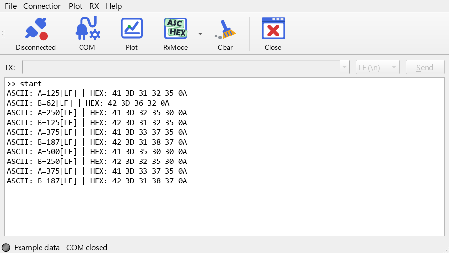
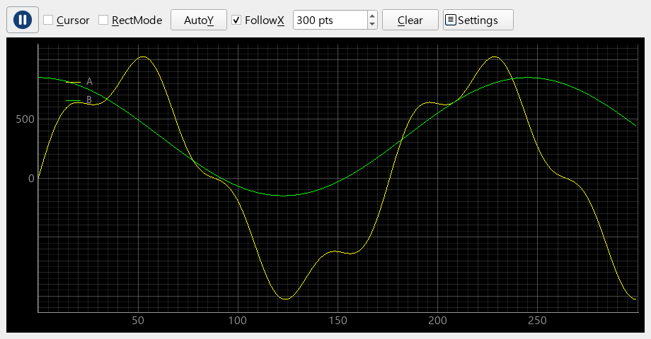
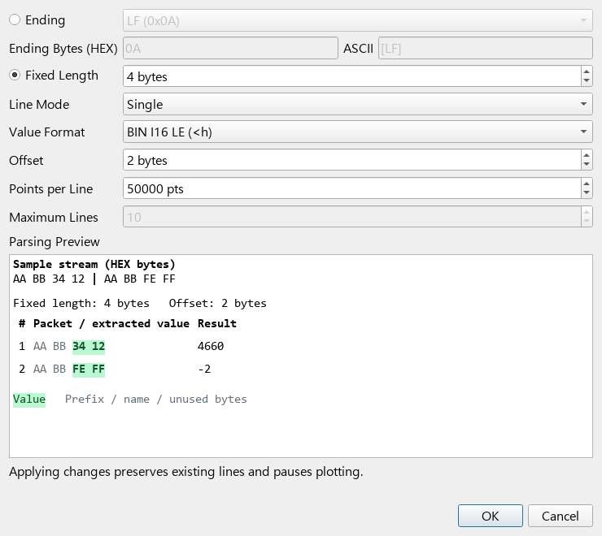

# SerialChart

A serial-port TX/RX terminal with real-time plotting for inspecting device data.

[Releases](https://github.com/ken51151/PySerialChart/releases) | [Changelog](CHANGELOG.md)

## Key Features

- **Interactive TX/RX Terminal**: Multi-mode display (ASCII/HEX) with command history and Tab completion.
- **Smart RX Framing**: Flexible packet parsing by line-ending or fixed-length, complete with idle flushing and a live preview.
- **Advanced Live Plotter**: Powered by pyqtgraph, featuring real-time visualization, custom cursors, auto-scaling, and built-in data export.
- **Cross-Platform Desktop App**: Built with Python and Qt for smooth, native performance across Windows, macOS, and Linux.

## Screenshot

**TX/RX terminal with ASCII + HEX display**



**Independent plot window with multiple curves**



<details>
<summary>Plot settings and live parsing preview</summary>



</details>

## Quick Start

**Windows ZIP:** extract the entire onedir package and run `SerialChart.exe`. Keep `_internal` beside the EXE; Python is not required. See [Releases](https://github.com/ken51151/PySerialChart/releases) for published downloads, or [build locally](packaging/README.md).

**From source:** use 64-bit Python 3.11 on Windows, preferably in a virtual environment. Run these commands from the project directory:

```shell
python -m pip install -r requirements.txt
python SerialChart.py
```

1. With COM closed, open **COM** to select the port and serial settings. Configure **Plot > Plot Settings** if plotting is needed.
2. Use **Connection > Connect** or the connection toolbar button. Choose the terminal display through **RxMode**, and framing through **RX > RX Settings**.
3. Open **Plot** and use its play/pause button to enable plotting. Closing that window pauses plotting and retains its curves.

COM and plot settings can only be changed while COM is closed; plot settings also wait for RX cleanup. Main-window **Clear** clears the terminal; Plot **Clear** clears curve data.

For multi-line ASCII plotting, send one `name=value` packet per configured ending, for example `speed=120` followed by LF. For raw HEX transmission, enter `hex: 01 02 0A FF`; no TX line ending is appended.

## Development and License

- Run tests: `python -m unittest discover -s tests -v`.
- Build a Windows ZIP: `python packaging/build_release.py`; details in [packaging/README.md](packaging/README.md).
- Planned work and historical decisions: [TODO.md](TODO.md). Version history: [CHANGELOG.md](CHANGELOG.md).
- Licensed under [GPL-3.0-only](LICENSE.txt). See [third-party notices](THIRD_PARTY_NOTICES.md) and [source/release requirements](SOURCE.md). Licenses are also available in **Help > Licenses**.
